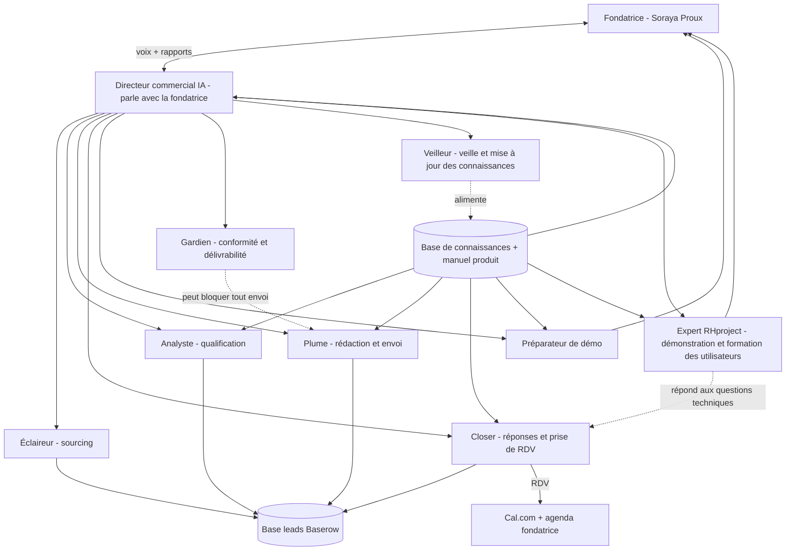

# Équipe commerciale IA RHproject — Architecture

Objectif : une équipe d'agents IA qui prospecte les entreprises d'échafaudage / BTP, qualifie, conduit la conversation jusqu'au rendez-vous, et ne mobilise la fondatrice que pour la **démonstration**. Aucun code : tout se configure dans des outils no-code (n8n, Instantly/Smartlead, Cal.com, Baserow, un assistant vocal).

> Statut des chiffres : les ordres de grandeur viennent de l'audit précédent (hypothèses, non mesurées). Les faits métier cités dans `connaissances/` viennent de recherches web listées avec leurs sources et à vérifier avant usage commercial.

## 1. Organigramme

## 2. Rôles (détail des consignes dans `agents.md`)

| Agent | Mission | Entrée → sortie | Autonomie au départ |
|---|---|---|---|
| **Directeur** | Fixe le plan du jour, arbitre, rend compte à la fondatrice, parle avec elle | KPI + remontées des agents → décisions + rapport | Propose, la fondatrice valide |
| **Éclaireur** | Trouve les entreprises (SIRENE, Maps, offres d'emploi) et les contacts | critères ICP → leads bruts | Autonome |
| **Analyste** | Note chaque lead (0-100) selon les pain points, justifie | lead brut → lead scoré + angle d'approche | Autonome, échantillon relu |
| **Plume** | Écrit et envoie les séquences personnalisées | lead scoré → emails / messages | **Validation fondatrice des modèles**, puis autonome |
| **Closer** | Lit les réponses, répond, lève les objections, propose des créneaux | réponse → RDV ou clôture | Réponses simples seules, cas sensibles escaladés |
| **Préparateur de démo** | Fiche 1 page avant chaque démo | RDV → brief (entreprise, enjeux, questions, objections probables) | Autonome |
| **Gardien** | Vérifie désinscriptions, base légale, santé des boîtes, qualité des messages | tous les envois → feu vert / blocage | Droit de veto |
| **Expert RHproject** | Connaît tout le produit (3 secteurs hors médical), prépare les démonstrations, forme les utilisateurs, répond aux questions techniques | manuels `produit/` → plans de formation, scripts de démo, réponses sourcées | Autonome sur le contenu, validé par le Directeur pour tout engagement |
| **Veilleur** | Alimente les connaissances (vente, métier), suit les nouvelles versions de l'application, teste les agents | sources et nouveaux builds → fiches mises à jour | Propose, le Directeur publie |

## 3. Flux de travail

1. **Chaque soir** : l'Éclaireur remplit la base, l'Analyste note, le Gardien contrôle.
2. **Chaque matin** : le Directeur fixe les volumes, la Plume envoie, le Closer traite les réponses de la veille.
3. **En continu** : tout RDV pris apparaît dans l'agenda de la fondatrice avec son brief de démo.
4. **Chaque jour** : rapport quotidien (voir `rapports.md`), échange vocal de 5 minutes sur demande.
5. **Chaque semaine** : revue des chiffres, des messages gagnants et perdants, décisions d'ajustement.

## 4. Le Directeur parle

Le Directeur est le **seul interlocuteur** de la fondatrice. Deux canaux, sans code :
- **Vocal** : un assistant vocal (ElevenLabs Agents ou Vapi, configuré avec le prompt du Directeur et accès en lecture à la base de leads et aux KPI). Il peut appeler la fondatrice pour le point du matin, ou être appelé à tout moment (« où en est-on ? »). Il ne fait **pas** de démarchage téléphonique.
- **Écrit** : un email quotidien et un canal de messagerie (Slack ou Telegram) pour les alertes.

Il connaît la fondatrice (profil, préférences, style de décision) via `connaissances/fondatrice-et-rhproject.md`, qu'elle complète. Il est aussi le **référent produit le plus pointu** : il maîtrise les manuels `produit/` (voir §10) et peut former des utilisateurs à l'oral.

## 5. Boîtes mail

| Usage | Adresse | Règle |
|---|---|---|
| Prospection (envoi de masse) | domaines secondaires dédiés (ex. variantes de rhproject) | **Jamais** depuis le domaine principal : une blacklist détruirait support@ et les mails clients |
| Réponses, confirmations de RDV, relation | `soraya.proux@rhproject.*` et `support@rhproject.*` (domaine exact à confirmer) | Le Closer répond depuis ces adresses une fois le prospect intéressé |
| Désinscription | lien dans chaque message + traitement automatique | obligatoire |

SPF, DKIM, DMARC sur tous les domaines ; warm-up de 2 à 3 semaines avant volume.

## 6. Garde-fous

- Aucun agent ne se fait passer pour un humain si on lui pose la question.
- Aucune promesse de fonctionnalité absente de la fiche produit validée.
- Le Gardien peut suspendre tous les envois (taux de rebond > 3 %, plaintes spam, litige).
- Tout sujet juridique, prix hors grille ou réclamation → escalade fondatrice.
- Autonomie croissante par paliers : semaines 1-2 tout est validé, semaines 3-4 seuls les cas sensibles, ensuite revue hebdomadaire.

## 7. Outils (no-code)

| Besoin | Outil | Coût indicatif |
|---|---|---|
| Orchestration | n8n | 0 à 20 €/mois |
| Base de leads / CRM | Baserow ou HubSpot Free | 0 € |
| Envoi email | Instantly ou Smartlead + boîtes sur domaines secondaires | ~40 € + ~3 à 6 €/boîte |
| Agenda | Cal.com + Google Calendar | 0 € |
| Voix du Directeur | ElevenLabs Agents ou Vapi | quelques € à dizaines d'€ selon usage |
| Modèle de langage | Claude (API) | variable, faible à ce volume |

## 8. Plan de mise en route

| Étape | Contenu | Durée | Qui |
|---|---|---|---|
| 0 | La fondatrice complète `fondatrice-et-rhproject.md` (offre, prix, preuves) | 1 jour | Fondatrice |
| 1 | Domaines, boîtes, SPF/DKIM/DMARC, début du warm-up | 2 jours + attente 2-3 semaines | Configuration |
| 2 | Base de connaissances et manuels `produit/` chargés, Directeur, Expert RHproject et agents créés avec leurs consignes ; test de connaissance de `produit/05` §7 | 3 jours | Configuration |
| 3 | Sourcing + qualification d'un premier lot de 500 leads, relecture par la fondatrice | 4 jours | Éclaireur, Analyste |
| 4 | Pilote : 30 à 50 contacts par jour, tout validé | 10 jours | Équipe |
| 5 | Montée en volume et en autonomie | 14 jours | Équipe |

## 9. Connaissance du produit (dossier `produit/`)

Les agents s'appuient sur une analyse complète de l'application RHproject (build 2026-04-08) : socle RH, options, secteurs **BTP/échafaudage**, **Nettoyage**, **Généraliste** (le secteur Médical est exclu), essai gratuit, guide de formation. Voir `produit/README.md` pour l'index et la matrice de couverture.

## 10. Ce qu'il reste à décider (par la fondatrice)

1. La fiche RHproject : les fonctions et les prix sont désormais connus par l'application ; il reste les **preuves clients**, la **cible commerciale prioritaire** et la **correction des points d'attention** (`produit/04` §6).
2. Le domaine exact et les adresses mail.
3. Le niveau d'autonomie voulu au départ.
4. Le recours éventuel à un juriste pour valider la conformité (voir `connaissances/conformite.md`).
